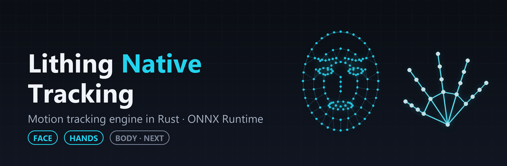

<div align="center">



# Lithing Native Tracking

**A standalone motion tracking engine in Rust, on ONNX Runtime: face and hands today, body next. Not tied to a web view, not tied to one app.**

[](Cargo.toml)
[](LICENSE)
[](https://www.rust-lang.org)
[](https://onnxruntime.ai)

[**Used by Vtuber-Lithing**](https://github.com/Happyuky7/Vtuber-Lithing) · [**Website**](https://vtuber-lithing.happyuky7.com/) · [**Engine docs in the app**](https://vtuber-lithing.happyuky7.com/docs/guide/tracking#native-tracking-engine-beta) · [**Discord**](https://discord.gg/shbsVYdBpJ)

</div>

---

**Lithing Native Tracking** is a motion tracking engine written in Rust. Today it tracks the face and the hands: camera or
video in, 478 face landmarks, 52 blendshapes, head pose, gaze, blinks and winks, and both
hands with every finger out, on their own threads, on the GPU (DirectML on Windows, CUDA)
or the CPU. It runs the MediaPipe face and hand models converted to ONNX. Body (pose) tracking is the next step, on the same pipeline.

It is a standalone engine: use it as a Rust library (`lithing-tracking`), as a Tauri plugin
(`lithing-tauri-plugin`) or from the command line (`lithing-track`), in any project, free or
paid, under the [MPL-2.0](#license). [Vtuber-Lithing](https://github.com/Happyuky7/Vtuber-Lithing)
uses it as its native tracking engine: the web view keeps rendering and receives about 600
bytes per frame.

| Crate | What |
|---|---|
| `crates/lithing-camera-controls` | "Keep frame rate": the webcam controls behind low-light frame drops (Media Foundation / V4L2), the policy and the restore journal. |
| `crates/lithing-tracking` | The library: capture (camera / video file), models, ROI tracking, post-processing, the threaded pipeline. |
| `crates/lithing-tracking-cli` | `lithing-track`: run, dump, benchmark (`bench`, `model-times`, `burn-cpu`, `burn-gpu`). |
| `crates/lithing-tauri-plugin` | `tauri-plugin-lithing-tracking` + `guest-js/` TypeScript client (`NativeFaceTracker`). |
| `crates/lithing-render` | Phase 2 skeleton (native VRM renderer interfaces). |
| `crates/lithing-shell` | Phase 3 skeleton (native UI shell and extension host interfaces). |

Docs: [ARCHITECTURE.md](ARCHITECTURE.md) (design, phases 1-3, measurements),
[INTEGRATION.md](INTEGRATION.md) (switching the app to it),
[MODELS.md](MODELS.md) (sources, licences, checksums).

## Build and run on Windows

Requirements: Rust (MSVC toolchain, tested with cargo 1.99), a DirectX 12 GPU
for DirectML (any vendor; the CPU path works without one). ONNX Runtime 1.31 is
downloaded and linked by the `ort` crate at build time; `DirectML.dll` is copied
next to the executables.

```powershell
# 1. Models (downloads the MediaPipe bundles from Google, converts, verifies checksums).
#    Needs Python 3.12 with venv for the conversion (`py -3.12`); see MODELS.md.
powershell -ExecutionPolicy Bypass -File scripts/fetch_models.ps1

# 2. Build and test
cargo build --release
cargo test

# 3. Track a video file like a 30 fps camera (prints per-second stats and a summary)
target\release\lithing-track run clip.y4m --ep auto --duration 20
target\release\lithing-track run clip.mp4 --ep cpu --lockstep --out results.jsonl   # needs ffmpeg on PATH

# Camera (index from `lithing-track cameras`)
target\release\lithing-track run camera:0 --ep auto

# 4. Benchmarks: idle / CPU load / GPU load / both / low-end (2 CPUs), each provider
target\release\lithing-track bench clip.y4m --duration 20 --out bench-results
target\release\lithing-track model-times --eps cpu,directml
```

Useful `run` options: `--face-fps`, `--hand-fps`, `--no-hands`, `--tongue`,
`--threads N` (per CPU session; 1 = on the worker thread itself),
`--priority below-normal|normal|...` (raised to normal automatically while starved unless `--fixed-priority`), `--serial` (face and hands on one
thread), `--palm-interval N` (look for a missing hand every N hand frames; 1 =
MediaPipe), `--affinity N` (pin to N CPUs: low-end simulation),
`--models DIR` (or `LITHING_MODELS`), `--raw-size WxH [--raw-fps N]` (input is
raw RGB24 frames, e.g. `ffmpeg -i clip -f rawvideo -pix_fmt rgb24 clip.rgb`).

The web tracker's Tracking options, on `run`, `dump` (and `bench` for the
first three): `--low-light`, `--high-light`, `--glasses`, `--no-mirror-face`,
`--no-mirror-hands`, `--stability 0..1`, `--finger-smoothing 0..1`,
`--hand-quality performance|balanced|precise`. `lithing-track filter clip
--mode low|high [--out filtered.rgb] [--log filters.jsonl]` runs only the
low / high light image filter and prints its cost per frame.

`LITHING_ORT_VERBOSE=1` prints ONNX Runtime's node placement per provider.

### Accuracy check against the web MediaPipe

```powershell
ffmpeg -i clip.y4m -start_number 0 frames\clip\%d.png
$env:LITHING_FRAMES="frames"; node tools/webref.mjs clip ref.jsonl CPU   # headless Chrome, needs puppeteer-core
target\release\lithing-track dump clip.y4m --ep cpu --palm-interval 1 --no-same-frame-redetect --out native.jsonl
node tools/compare_reference.mjs native.jsonl ref.jsonl 640 480

# Per mode, on identical pixels (raw RGB24): the web side runs the app's own FaceTracker
# (light filter on its canvases, processFace) and both sides write TrackingData.
ffmpeg -i clip.mp4 -f rawvideo -pix_fmt rgb24 clip.rgb
node tools/webref.mjs clip ref.jsonl CPU --raw clip.rgb --size 640x480 --fps 25 --mode low   # or --mode high, --glasses
target\release\lithing-track dump clip.rgb --raw-size 640x480 --raw-fps 25 --ep cpu --palm-interval 1 --no-same-frame-redetect --low-light --out native.jsonl
node tools/compare_reference.mjs native.jsonl ref.jsonl 640 480
```

### Keep frame rate (cameras in low light)

Many webcams lengthen their exposure in a dim room and drop from 30/60 to
15 fps or less ("auto exposure priority", "low light compensation"), which
feels like lag. Camera runs keep the rate by default:

1. The first 2 s run with the camera's own settings (delivered fps *before*).
2. Auto-exposure priority is turned off (UVC `CT_AE_PRIORITY_CONTROL`: Windows
   `KSPROPERTY_CAMERACONTROL_AUTO_EXPOSURE_PRIORITY`, Linux
   `exposure_auto_priority` / `exposure_dynamic_framerate`), and the Windows
   extended "variable frame rate" control where a driver has it. Auto
   exposure stays on; the picture gets darker rather than slower (the low
   light mode brightens it).
3. Only if the rate still stays under 80 % for 3 s (no such control, or a
   camera that ignores it): manual exposure at the longest value that fits
   the frame period, gain (else brightness) raised, then steered by the frame
   brightness; automatic exposure comes back when the room is bright again.
4. Every control changed is put back when tracking stops or the option is
   turned off. A journal file in the temp folder covers crashes: the next
   open of the same camera restores what a killed run left changed.

Virtual cameras (NVIDIA Broadcast, OBS Virtual Camera, AMD Privacy View,
...) are not touched. `--no-keep-fps` (or `setKeepFrameRate(false)` in the
app) leaves the camera alone.

```powershell
# Controls of every camera, read without streaming (skipped while another app uses a camera; --force overrides, --json for JSON)
target\release\lithing-track cameras --controls
# Modes (format, resolution, fps) of every camera, and tracking in one of them instead of Auto
target\release\lithing-track cameras --formats
target\release\lithing-track run camera:0 --mode MJPEG:1280x720@30 --duration 20
```

**Manual test** (needs the physical camera; nothing else may use it):

1. Close Vtuber-Lithing and every app that uses the webcam (OBS, Discord,
   NVIDIA Broadcast, the browser).
2. Dim the room (or turn away from the light) until the camera's own app
   looks noisy.
3. `target\release\lithing-track run camera:0 --keep-fps --duration 20`
   and note the summary block: `delivered before X / after Y fps`, the
   strategy, each control change and `restored: ...`. The per-second lines
   show `camera NN fps (strategy)`.
4. `target\release\lithing-track run camera:0 --no-keep-fps --duration 20`:
   the rate should stay at the dropped value (e.g. 15) while the first run
   ends near the negotiated rate (30 / 60).
5. `target\release\lithing-track cameras --controls` afterwards: the values
   (e.g. `auto-exposure-priority 1`, `exposure ... auto`) must equal the ones
   before step 3.

## Linux

* Build the same way (`cargo build --release`); DirectML is Windows-only, so
  build with `--no-default-features --features camera` (CPU) or add `cuda`
  (`--features camera,cuda`, needs CUDA 12 + cuDNN 9; Auto then uses CUDA).
  The workspace dependency on `lithing-tracking` has no default features, so
  a crate that wants DirectML must ask for it (the Tauri plugin's `directml`).
* The camera backend generates its V4L2 bindings with bindgen: install
  `clang` and `libclang-dev` (Debian / Ubuntu) or `clang-devel` (Fedora).
* The static ONNX Runtime that `ort` downloads for x86_64 Linux needs glibc
  2.38 and GCC 13's libstdc++ to link (Debian 13, Ubuntu 24.04 or newer). For
  binaries that run on older distributions, build with the `load-dynamic`
  feature and ship Microsoft's `libonnxruntime.so` (glibc 2.28; from the
  `Microsoft.ML.OnnxRuntime` NuGet package, `runtimes/linux-x64/native/`):
  it is loaded from `inference::set_runtime_library` (the Tauri plugin passes
  `<resources>/libonnxruntime.so`), else `ORT_DYLIB_PATH`, else next to the
  executable, else the system's library path. The app's Linux packages do
  this and bundle the models under `<resources>/models`.
* Cameras go through V4L2 (nokhwa `input-v4l`); your user must be in the
  `video` group. "Keep frame rate" writes the V4L2 controls of
  `/dev/videoN` (`v4l2-ctl -d N -L` shows the same ones).
* Thread priority below normal is a per-thread nice value; `--affinity` prints
  the `taskset` command to use instead.
* `scripts/fetch_models.sh` needs `python3.12`, `curl` and `sha256sum`.

## Android (experimental)

* `lithing-tracking` builds for `aarch64-linux-android` (and `x86_64-linux-android`)
  with `--no-default-features --features nnapi`: `ort` downloads its static ONNX
  Runtime 1.31 build for Android (NNAPI included; no XNNPACK), linked into the
  library. That build needs the NDK's `libc++_shared.so` next to the library
  (an app puts it in `jniLibs/<abi>`). Cross-compiling needs the NDK's clang as
  linker (`CARGO_TARGET_AARCH64_LINUX_ANDROID_LINKER=<ndk>/toolchains/llvm/prebuilt/<host>/bin/aarch64-linux-android24-clang`).
* nokhwa has no Android backend, so the camera comes from the host:
  `push::push_source` gives a live `FrameSource` and a `FramePusher` that takes
  RGB or YUV 4:2:0 images with any strides (Android's `YUV_420_888`), converts
  and rotates them upright, newest frame wins. The Tauri plugin's `android/`
  library does this with Camera2 (`LithingCameraPlugin.kt`, front cameras
  first, frames to Rust through JNI `LithingNative.pushFrame`), closes the
  camera while the app is in the background, and copies the models from the
  APK's `assets/models` to the app's files folder.
* Providers: `cpu` (Auto is the CPU on Android) and `nnapi` (explicit only:
  drivers differ too much between phones).
* Tests run on a device or emulator: build them with
  `cargo test -p lithing-tracking --target x86_64-linux-android --no-default-features --features nnapi --no-run`,
  `adb push` the binary, `libc++_shared.so` and the models, then
  `LD_LIBRARY_PATH=. LITHING_MODELS=<dir> ./lithing_tracking-<hash>`.

## Status

Working (phase 1): camera/file capture on its own thread with newest-frame-wins
mailboxes; face (478 landmarks + 52 blendshapes) and hands (21 image + world
landmarks, handedness) on DirectML / CPU / Auto with re-detection only on loss;
face and hands of one frame emitted together; ports of head pose, blinks with
calibration, gaze, One Euro filters, finger articulation and gestures,
crossed-hands side assignment and the tongue detector; the Tauri plugin and
TypeScript client; every Tracking option of the web tracker, including the
low / high light image filters (Chromium's canvas filter reproduced natively,
see ARCHITECTURE.md "Light filters") and glasses mode; benchmarks and
accuracy tools; Android (experimental: Camera2 through the plugin, CPU / NNAPI).
Not done: the camera preview in the web view while native tracking runs
(INTEGRATION.md lists what stays web-only).

## License

The Vtuber-Lithing native tracking engine is licensed under the [Mozilla Public License 2.0](LICENSE) (MPL-2.0).

- You can use it for free, in free or paid products, open or closed source.
- If you change files of this engine and distribute the result, those changed files must stay under the MPL-2.0 and their source must be available. Your own code that uses the engine can keep any license.
- Keep the copyright and license notices: the engine stays credited to its author and cannot be presented as your own.

Contributions are welcome and are accepted under the same license.

The ONNX models in `models/` are converted from Google's MediaPipe models and keep their Apache-2.0 license (see MODELS.md).

## Contributors ✨

Thanks goes to these wonderful people ([emoji key](https://allcontributors.org/docs/en/emoji-key)):

<!-- ALL-CONTRIBUTORS-LIST:START - Do not remove or modify this section -->
<!-- prettier-ignore-start -->
<!-- markdownlint-disable -->
<table>
  <tbody>
    <tr>
      <td align="center" valign="top" width="14.28%"><a href="https://happyuky7.com"><br /><sub><b>Happyuky7</b></sub></a><br /><a href="https://github.com/Happyuky7/lithing-native-tracking-rs/commits?author=Happyuky7" title="Code">💻</a> <a href="#research-Happyuky7" title="Research">🔬</a> <a href="#maintenance-Happyuky7" title="Maintenance">🚧</a></td>
    </tr>
  </tbody>
</table>

<!-- markdownlint-restore -->
<!-- prettier-ignore-end -->

<!-- ALL-CONTRIBUTORS-LIST:END -->

This project follows the [all-contributors](https://github.com/all-contributors/all-contributors) specification. Contributions of any kind welcome!

## Part of Vtuber-Lithing

| Repository | What |
| --- | --- |
| [Vtuber-Lithing](https://github.com/Happyuky7/Vtuber-Lithing) | The application (Windows, Linux, Android) |
| [vtuber-lithing-sdk](https://github.com/Happyuky7/vtuber-lithing-sdk) | TypeScript SDK for extensions (plugins / addons) |
| [vtuber-lithing-sdk-examples](https://github.com/Happyuky7/vtuber-lithing-sdk-examples) | Ready-to-build example extensions |
| [lithing-native-tracking-rs](https://github.com/Happyuky7/lithing-native-tracking-rs) | Native motion tracking engine in Rust (face and hands; body next) |

Website and documentation: <https://vtuber-lithing.happyuky7.com/> · Community: [Discord](https://discord.gg/shbsVYdBpJ)

## Star History

<a href="https://www.star-history.com/#Happyuky7/lithing-native-tracking-rs&Date">
  <picture>
    <source media="(prefers-color-scheme: dark)" srcset="https://api.star-history.com/svg?repos=Happyuky7/lithing-native-tracking-rs&type=Date&theme=dark" />
    <source media="(prefers-color-scheme: light)" srcset="https://api.star-history.com/svg?repos=Happyuky7/lithing-native-tracking-rs&type=Date" />
    
  </picture>
</a>

---

<div align="center">

**Happy coding!** 💚

</div>
